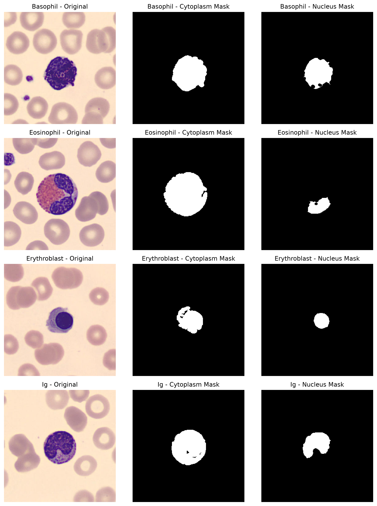
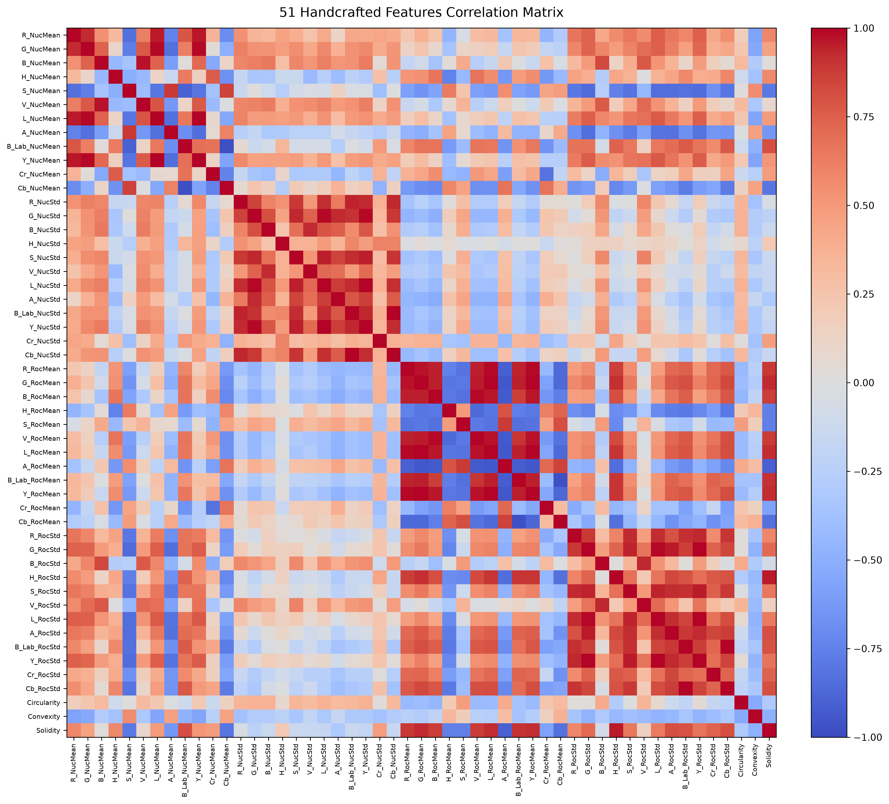
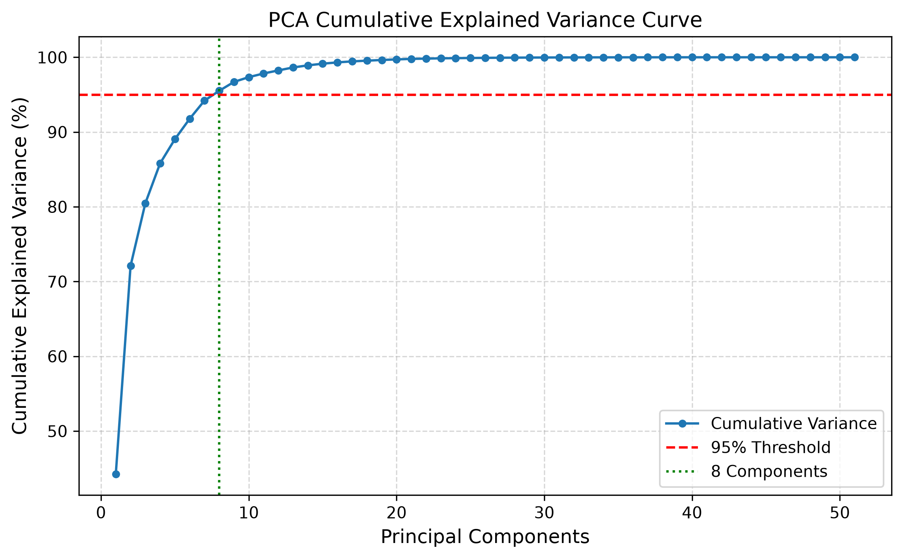
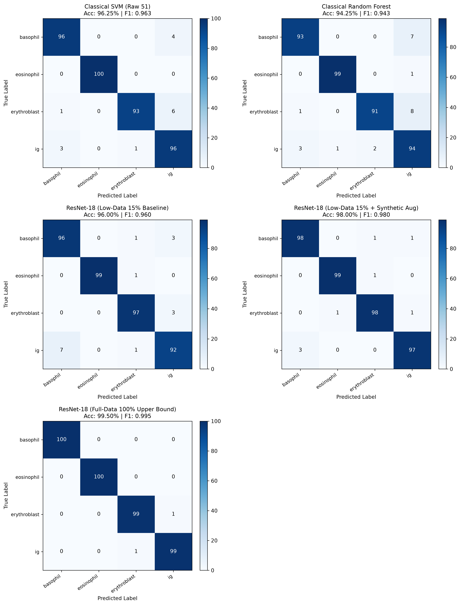
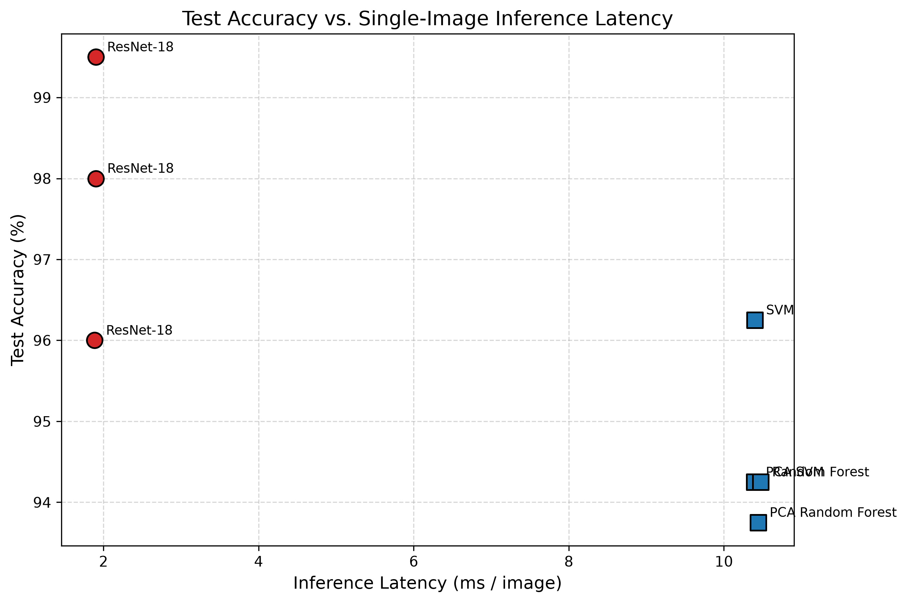

# White Blood Cell Segmentation & Comparative Benchmarking Framework

A modular Python framework for leukocyte (WBC) morphological segmentation, handcrafted feature extraction, and comparative benchmarking against PyTorch transfer learning under data scarcity constraints on the `bloodcells_4classes_500/` dataset (2,000 images across 4 classes: `basophil`, `eosinophil`, `erythroblast`, `ig`).

---

## 1. System Architecture & Methodology

The repository provides two complementary classification methodologies evaluated under an identical stratified 60/20/20 train/validation/test split:

```
                            Input Smear RGB (256x256)
                                       │
                      ┌────────────────┴────────────────┐
                      ▼                                 ▼
             [Classical Pipeline]              [Deep Learning]
                      │                                 │
           Grey-World Balance (RGB)            Train Regimes (ResNet-18):
                      │                        ├─ 1. Low-Data 15% Baseline
            Multi-Color Conversions            ├─ 2. Low-Data 15% + Domain Aug
         (CMYK, HLS, HSV, LAB, YCrCb)          └─ 3. Full-Data 100% Upper Bound
                      │                                 │
              Soft-Map Synthesis               PyTorch GPU Inference
        sftmap = (S_hsv - S_hls) + ...                  │
                      │                        Output Class Prediction
           Morphological Segmentation
         ├─ Cytoplasm (Otsu + Hull)
         └─ Nucleus (Gauss + Multi-Otsu)
                      │
           51 Handcrafted Features
         ├─ 3 Shape Descriptors
         └─ 48 Multi-channel Ratios
                      │
           StandardScaler + PCA (0.95)
                      │
            SVM (OvO) / Random Forest
                      │
           Output Class Prediction
```

### 1.1 Classical Pipeline

1. **Preprocessing & Color Normalization**:
   - Resized to $256 \times 256$ spatial resolution.
   - Per-channel Grey-World balance: $I_{c,\text{bal}} = \min(255, I_c \cdot (\mu_{\text{gray}} / \mu_c))$.
   - Conversion into 5 color spaces: CMYK, HLS, HSV, CIELAB, and YCrCb.
2. **Soft-Map Generation**:
   $$\text{sftmap} = (S_{\text{HSV}} - S_{\text{HLS}}) + \left(\min(M, S_{\text{HLS}}) - \min(\min(M, S_{\text{HLS}}), K)\right)$$
3. **Morphological Segmentation**:
   - **Cytoplasm**: Global Otsu binarization on `sftmap`, morphological hole filling, disk dilation ($r=3$), and connected-component filtering retaining the largest connected region.
   - **Nucleus**: Gaussian filtering ($5 \times 5$, $\sigma = 1.0$) on `sftmap` (fallback to Magenta channel $M$), Otsu thresholding, disk erosion ($r=3$), logical conjunction with cytoplasm mask, and primary contour filling.
   - **Auxiliary Regions**: Cytoplasm Convex Hull (`cv2.convexHull`) and Region of Cytoplasm ($ROC = CH \land \neg \text{Nucleus}$).
4. **51 Handcrafted Descriptors**:
   - **3 Shape Descriptors**: Nucleus Circularity ($P^2 / (4 \pi A)$), Cytoplasm-to-Nucleus Convexity ($P_{\text{CH}} / P_{\text{Nuc}}$), and Nucleus-to-ConvexHull Solidity ($A_{\text{Nuc}} / A_{\text{CH}}$).
   - **48 Color Ratio Descriptors**: Across 12 channels ($R, G, B, H, S, V, L, A, B, Y, Cr, Cb$), computing the ratio of mean and sample standard deviation of pixel intensities for $\text{Nucleus} / \text{ConvexHull}$ (24 features) and $\text{ROC} / \text{ConvexHull}$ (24 features).
5. **Classifiers**:
   - Support Vector Machine with One-vs-One decision function.
   - Random Forest (100 estimators).
   - Evaluated both on raw 51 features and with PCA retaining 95% cumulative explained variance (8 components).
   - Strict zero-leakage enforcement via `sklearn.pipeline.Pipeline`, fitting transformers strictly on `X_train`.

### 1.2 Deep Learning Transfer Benchmark

Fine-tuned `torchvision.models.resnet18` initialized with ImageNet pre-trained weights across three regimes:
1. **Low-Data Baseline (15% Data, 45 images/class)**: Standard resizing and ImageNet normalization.
2. **Low-Data + Synthetic Domain Augmentations (15% Data, 45 images/class)**: Photometric stain jitter (`ColorJitter`), affine translations and rotations, perspective warps, additive Gaussian noise, and synthetic cutout (`RandomErasing`).
3. **Full-Data Upper Bound (100% Data, 300 images/class)**: Complete training split with standard normalization.

---

## 2. Empirical Benchmark Results

Evaluated on the held-out test split of 400 images (100 samples per class):

| Architecture / Model | Regime / Features | Test Accuracy (%) | Macro F1 | Sensitivity (Eosinophil) | Specificity (Eosinophil) | Latency (ms/img) |
| :--- | :--- | :---: | :---: | :---: | :---: | :---: |
| **SVM** | Classical (Raw 51 Feats) | **96.25%** | **0.9627** | 1.0000 | 1.0000 | 10.40 |
| **PCA SVM** | Classical (PCA 95%, 8 comps) | 94.25% | 0.9429 | 1.0000 | 1.0000 | 10.39 |
| **Random Forest** | Classical (Raw 51 Feats) | 94.25% | 0.9431 | 0.9900 | 0.9967 | 10.47 |
| **PCA Random Forest** | Classical (PCA 95%, 8 comps) | 93.75% | 0.9380 | 0.9600 | 0.9900 | 10.44 |
| **ResNet-18** | Low-Data 15% (No Aug) | 96.00% | 0.9600 | 0.9900 | 1.0000 | 1.89 |
| **ResNet-18** | Low-Data 15% + Domain Aug | **98.00%** | **0.9800** | 0.9900 | 0.9967 | 1.90 |
| **ResNet-18** | Full-Data 100% Upper Bound | **99.50%** | **0.9950** | 1.0000 | 1.0000 | 1.90 |

### Key Experimental Insights

1. **Classical vs. Low-Data Deep Learning**: Without augmentation, ResNet-18 trained on only 15% of the data (180 training images) reaches 96.00% accuracy, matching the classical SVM (96.25%).
2. **Efficacy of Domain-Specific Augmentation**: Introducing photometric stain jitter, spatial transformations, Gaussian noise, and cutout under data scarcity boosts ResNet-18 performance from 96.00% to **98.00%** (+2.0% accuracy, +0.0200 Macro F1), surpassing all classical pipelines while using 85% less training data.
3. **Eosinophil Granule Discrimination**: Eosinophils exhibit distinct cytoplasmic granulations and staining characteristics, yielding 99.0%–100.0% sensitivity and 99.6%–100.0% specificity across both classical and deep learning models.
4. **Latency Analysis**: Deep learning GPU inference requires **1.90 ms/image**. Classical inference requires **10.40 ms/image**, of which 10.38 ms is dedicated to color space transformations, Gaussian filtering, morphological operations, and vectorized mask indexing, while SVM prediction takes only 0.01 ms.

---

## 3. Visuals

### Segmentation Comparison
Multi-panel validation showing input microscopy smear images, derived cytoplasm masks, and segmented nucleus masks across all four target classes:



### Feature Correlation Heatmap
Correlation matrix across the 51 handcrafted features, highlighting redundancy among color ratios across related channels:



### PCA Cumulative Explained Variance
Cumulative explained variance curve fitted strictly on the training partition ($N=1,200$). 8 principal components account for $\ge 95\%$ of the total variance:



### Multi-Model Confusion Matrices
Normalized test confusion matrices comparing Classical SVM and Random Forest against ResNet-18 across low-data and full-data regimes:



### Accuracy vs. Single-Image Inference Latency
Comparative trade-off between classification accuracy and per-sample processing latency:



---

## 4. Repository Structure

```
├── bloodcells_4classes_500/      # 2,000 peripheral smear images (500/class)
├── results/
│   ├── benchmark_table.md         # Generated empirical markdown benchmark
│   ├── classical_metrics.json     # Detailed classical classification metrics
│   ├── features.csv               # Cached 51-feature matrix for 2,000 samples
│   ├── metrics_summary.json       # Combined benchmark JSON metrics
│   └── figures/                   # 5 high-resolution evaluation figures
├── scripts/
│   ├── run_classical_pipeline.py  # End-to-end classical segmentation and ML
│   └── run_dl_benchmark.py        # PyTorch ResNet-18 3-regime benchmark
├── src/
│   ├── classical/
│   │   ├── preprocessing.py       # Color balancing and multi-color-space mapping
│   │   ├── segmentation.py        # Morphology-based cytoplasm and nucleus masks
│   │   ├── features.py            # Vectorized shape and color ratio extraction
│   │   └── classifiers.py         # Zero-leakage sklearn pipelines
│   ├── deep_learning/
│   │   ├── augmentations.py       # Domain-specific synthetic augmentations
│   │   ├── dataset.py             # Stratified PyTorch datasets and loaders
│   │   ├── transfer_model.py      # ResNet-18 architecture head adaptation
│   │   └── train_eval.py          # Training, early stopping, and latency measurement
│   └── utils/
│       ├── metrics.py             # Sensitivity, specificity, F1, accuracy metrics
│       └── visualization.py       # Matplotlib figure generation routines
├── pyproject.toml             # Project build configuration and dependencies
├── uv.lock                    # Exact dependency lockfile
├── .gitignore
└── README.md
```

---

## 5. Reproduction Instructions

### 5.1 Environment Setup

Install dependencies and set up the virtual environment using `uv`:

```bash
uv sync
source .venv/bin/activate
```

### 5.2 Execute Classical Pipeline

Run preprocessing, segmentation, feature extraction, and classifier training:

```bash
python scripts/run_classical_pipeline.py
```

Outputs:
- `results/features.csv`
- `results/classical_metrics.json`
- `results/figures/segmentation_visual_comparison.png`
- `results/figures/feature_correlation_heatmap.png`
- `results/figures/pca_cumulative_variance.png`
- `results/figures/confusion_matrices_classical.png`

### 5.3 Execute Deep Learning Benchmark

Run transfer learning across Low-Data Baseline, Low-Data + Synthetic Augmentation, and Full-Data regimes:

```bash
python scripts/run_dl_benchmark.py
```

Outputs:
- `results/metrics_summary.json`
- `results/benchmark_table.md`
- `results/figures/confusion_matrices_all.png`
- `results/figures/accuracy_vs_latency.png`
